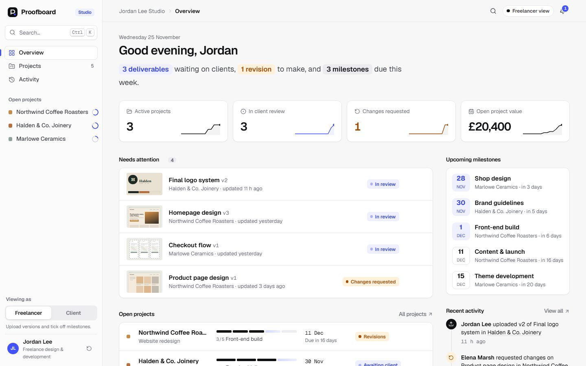

# Proofboard

**Client review, without the email chains.** Proofboard is a workspace where freelancers and
clients track project progress, review deliverables, exchange feedback and approve finished
work.

> Live demo: [proofboard-seven.vercel.app](https://proofboard-seven.vercel.app) · Part of [my portfolio](https://portfolio-beta-gilt-2tyi5pjln6.vercel.app)



## Features

- **Overview** that opens with a plain-language summary ("3 deliverables are waiting on clients…"),
  key numbers, a "needs attention" list, open projects, upcoming milestones and recent activity
- **Projects** list with status filters (in progress, awaiting client, revisions, completed),
  search and sorting
- **Segmented milestone bars** (one segment per milestone) and a milestone checklist
- **Deliverable review**: CSS-drawn previews in each client's brand palette, version numbers,
  and approve / request-changes actions (a change request requires a note)
- **Comment threads** on every deliverable
- **Role switch**: act as the freelancer (upload new versions, tick off milestones) or the
  client (approve or request changes). Permissions change with the role.
- **Notifications** popover with unread counts and an **activity timeline** grouped by day and
  filterable by type and project
- Everything persists in `localStorage`. "Reset demo data" restores the sample workspace.

## Built with

React 19 · Vite · React Router 7 · `useReducer` + Context · plain CSS with container queries ·
the native **View Transitions API** · Lucide icons · Geist / Geist Mono

## Motion & interaction

- Navigation runs through `document.startViewTransition` (`src/lib/transitions.jsx`), so pages cross-fade and
  a project's colour swatch morphs from the list into the project header.
- **⌘K / Ctrl+K** (or `/`) opens a command menu with fuzzy search over pages, projects, deliverables and actions.
- Stat numbers count up, sparklines draw themselves, milestone bars fill segment by segment, and actions
  confirm with stacked toasts (hover the stack to fan it out).
- No animation library. Everything is CSS, native APIs and a little `requestAnimationFrame`.

## How the state works

Every change goes through one reducer in `src/context/BoardContext.jsx`
(`APPROVE`, `REQUEST_CHANGES`, `UPLOAD_VERSION`, `ADD_COMMENT`, `TOGGLE_MILESTONE`, …).
Each action also writes an activity entry, so the notifications, timeline and project data
always agree. Project status is derived (never stored), for example "awaiting client" whenever a
deliverable is in review.

## Project structure

```
src/
  components/   Sidebar, Topbar (search + notifications), RoleSwitch, ProjectRow,
                ReviewPanel, DeliverablePreview, ActivityList, Bits (badges, milestone bar)
  context/      BoardContext: reducer, persistence, derived notifications
  data/         seed.js: sample projects, generated relative to today
  pages/        Overview, Projects, ProjectDetail, Activity, NotFound
  utils/        project.js: status, progress, dates, money formatting
```

## Run locally

```bash
npm install
npm run dev        # http://localhost:5175
```

## Build & deploy

```bash
npm run build      # outputs to dist/
npm run preview
```

Import the repository on [Vercel](https://vercel.com). `vercel.json` handles client-side
routes such as `/projects/halden-identity`.

---

Proofboard is a portfolio concept: clients, projects and people are fictional.
